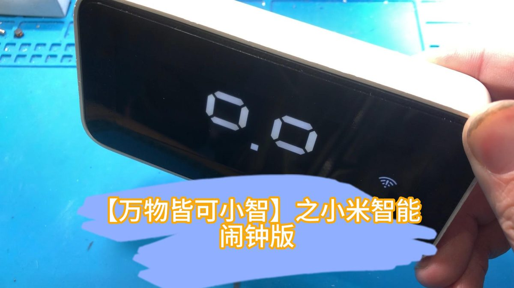

# 小米智能闹钟 · ESP32-S3 改装版

把家里的小米智能闹钟「掏空重装」：保留原装镜面外壳，换成自画的 ESP32-S3 QFN56 裸片主板 + TM1652 四位数码管 + I2S 功放 + WS2812B 氛围灯。同一块硬件提供**两套固件**，按需烧录。

- 🔥 **在线烧录（不用装工具，浏览器直接刷）**：<https://mi-alarm-esp32s3.515166.xyz/>
- 📺 **改装全过程（B 站视频）**：[【万物皆可小智】之小米智能闹钟版](https://www.bilibili.com/video/BV1T4sq62EYT)
- 🧰 **详细固件文档与迭代记录**：[`ESP32S3-PCB/ino/README.md`](ESP32S3-PCB/ino/README.md)
- 🔌 **硬件接线表**：[`ESP32S3-PCB/硬件接线表.md`](ESP32S3-PCB/硬件接线表.md)



## 两套固件

| | 基础版（Arduino 自研） | 小智版（小智 AI） |
| --- | --- | --- |
| 版本 | v4.8.12 | v1.0.2（小智 v2.6.0 + 板级适配） |
| 镜像 | 16 MB merged | 8.54 MB merged |
| 主打 | 真人整点报时、闹铃闪灯、网页配网与设置 | 中文 AI 语音对话、唤醒显示表情 |
| 特色 | 24 段真人录音报时 + 6 段铃声，全在 flash 数组本地播放 | 「你好小智」唤醒词、数码管亮度语音控制、UDP 3333 调试口 |
| 交互 | 主按键按下即全局静音；双击切 12/24；长按 8 秒进配网 | 语音对话 + GPIO2 长按恢复出厂 |

两者共用同一块硬件，**分区表不同，互刷必须擦除 Flash**。

## 基础版主要功能

- **真人报时**：24 段整句录音 + 6 段铃声直接编进 flash 数组（约 3.8 MB），到点本地播放，不用拼音频。
- **闹铃与氛围灯**：闹铃响时 WS2812B 以 2Hz 红色明灭提醒，且无视网页氛围灯开关；主按键按下瞬间全局静音（响铃按设置排贪睡，试听/报时只停不排）。
- **数码管自愈**：TM1652 单向写、写歪了读不回来，固件用「连写两遍 + 3 秒兜底重写」压掉缺笔画；时间画面每 500ms 冒号翻转也自愈。
- **网页配网与安全**：所有写操作要过 4 位验证码，码只显示在数码管上、必须主动点「获取验证码」才出、30 秒消失、60 秒冷却；配网页用热点一开就异步预扫描 + 结果缓存，WiFi 列表秒出，手机连热点自动弹页。
- **时间**：无外部 RTC，NTP 联网校时；断电重连自动恢复。

## 硬件

- 主控：ESP32-S3 QFN56 裸片，16 MB Flash + 8 MB PSRAM（40 MHz）
- 显示：TM1652 四位数码管，单线 SDA（GPIO1）
- 音频：MAX98357 I2S 功放（DIN/BCK/LRCK = GPIO7/8/9）；ICS-43434 I2S 麦克风预留（GPIO4/5/6）
- 灯：WS2812B × 2 串联（GPIO10）
- 按键：主按键 GPIO0（BOOT），副按键 GPIO2（基础版长按 8 秒恢复出厂 / 小智版长按 5 秒）
- 完整引脚与电气注意见 [`ESP32S3-PCB/硬件接线表.md`](ESP32S3-PCB/硬件接线表.md)

> **硬件红线**：`VDD3P3_RTC` 必须接 3.3V，悬空会导致芯片不启动、USB 不枚举；GPIO0 上电时别按住；TM1652 与 WS2812B 是 5V 器件，3.3V 数据电平处于 VIH 边缘；32.768 kHz 晶振 X2 不要装。

## 烧录

### 在线烧录（推荐）

打开 <https://mi-alarm-esp32s3.515166.xyz/>，选固件 → 插 USB-C → 点「连接设备并烧录」→ 在浏览器弹窗里选串口 → 勾选擦除 Flash → 等 2~4 分钟。全程在浏览器本地完成，固件不经过服务器。

需要桌面版 Chrome / Edge / Firefox（iOS 全系不支持 Web Serial），HTTPS 访问。烧的是整盘 merged 镜像（偏移 `0x0`），NVS 已清空，首次开机需要重新配网。发布页背后的原理和加版本步骤见 [`docs/DEPLOY.md`](docs/DEPLOY.md)。

### 本地编译

```bash
cd ESP32S3-PCB/ino
sh build.sh     # arduino-cli 编译 → 契约自检 → 导出 app/merged bin → 打印 SHA256
sh flash.sh /dev/cu.usbmodemXXXX          # 只烧 app，保留设置
sh flash.sh /dev/cu.usbmodemXXXX --full   # 全片烧录，清 NVS/设置
sh flash.sh /dev/cu.usbmodemXXXX --part   # 引导+分区表+app，保留 NVS
```

依赖 `arduino-cli 1.3.1` 与 `esp32:esp32 3.3.12`。`build.sh` 里覆盖了 16MB 分区属性（app 6.55 MB / SPIFFS 3.54 MB）；不要加 `CDCOnBoot=cdc`，那会关掉 USB CDC 日志。`flash.sh` 带芯片身份校验，会自动跳过接在同一台电脑上的其它 USB 设备（例如 ZMK 键盘）。

## 目录结构

```
.
├── docs/                      在线烧录发布页（GitHub Pages 源目录）
│   ├── index.html / config.json / css / js
│   ├── firmware/              两套 merged 镜像
│   ├── manifests/             esp-web-tools 清单（ESP32-S3 / offset 0）
│   ├── img/                   实拍 + SVG 示意图
│   ├── DEPLOY.md              发布页维护与加版本说明
│   └── CNAME                  自定义域名
├── ESP32S3-PCB/
│   ├── 硬件接线表.md
│   └── ino/                   基础版固件源码、音频生成脚本、README
└── firmware_backup/           历史版本归档（不进发布）
```

## 安全说明

发布出去的 merged 镜像都实测过 NVS 分区全 `0xFF`，不含 WiFi 密码或账号密钥。基础版网页的写操作需要数码管验证码，会话 120 秒无请求回收；从 192.168.4.x 配网热点进来免验证，作为没有显示屏时的逃生门。**残余风险**：当前写操作仍是 GET + Cookie，无法完全挡住顶级导航触发的跨站请求，后续计划改 POST + 校验 `Sec-Fetch-Site`。

## 已知限制

- 只支持 2.4 GHz WiFi（ESP32 不支持 5 GHz）。
- 没有外部 RTC，断电后联网会重新校时。
- 闹钟最多 5 组。
- 在线烧录需桌面浏览器 + HTTPS；16 MB 镜像下载加烧录约 2~4 分钟，期间别拔线。

## 致谢

在线烧录由 [esp-web-tools](https://github.com/esphome/esp-web-tools) 提供浏览器端 Web Serial 能力；小智版基于 [xiaozhi-esp32](https://github.com/78/xiaozhi-esp32) v2.6.0。

Made by Dayu.
